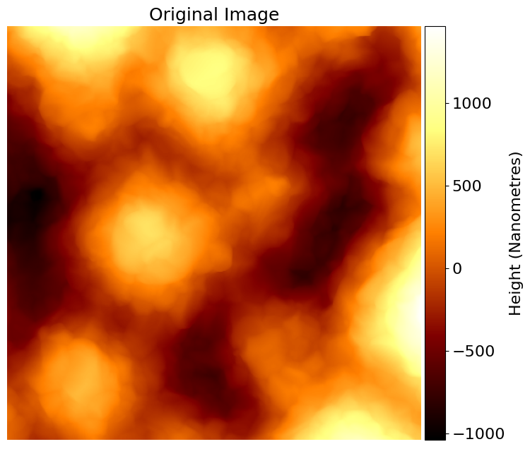
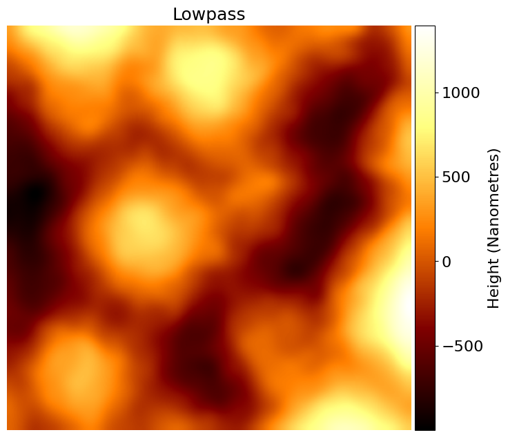
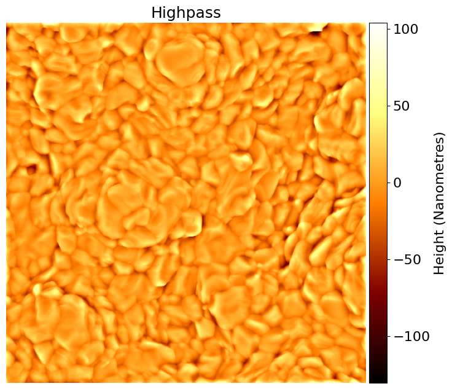
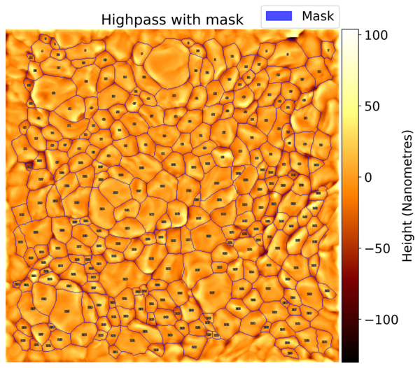
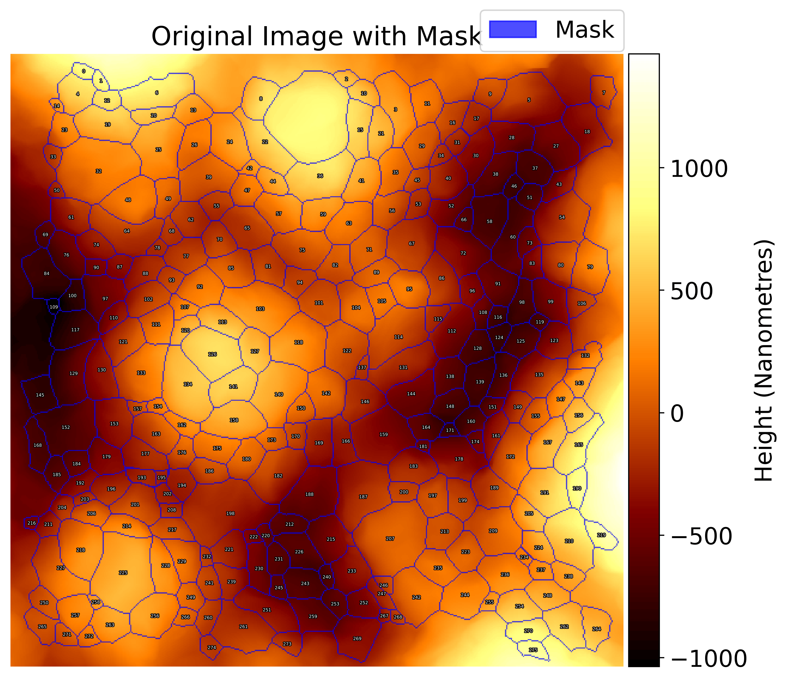

# PerovStats

An program to process AFM scans of perovskite and generate usable data and statistics.

Basic instructions are provided in this page. For detailed intructions and explanations of PerovStats please read and/or follow the documentation:

- [Installation guide](docs/installation.md)
- [Configuration guide](docs/config.md)
- [Usage guide](docs/usage.md)
- [Issue reporting guide](docs/issues.md)
- [Updating guide](docs/updating.md)

## Installation

Full instructions for installing PerovStats can be found in the [installation guide](docs/installation.md). It is recommended to follow these to ensure correct versioning.

To install PerovStats directly from GitHub via ssh:

```console
pip install git@github.com:AFM-SPM/PerovStats.git
```

To install PerovStats by cloning from the GitHub repository:

```console
git clone https://github.com/AFM-SPM/PerovStats.git
cd PerovStats
pip install -r requirements.txt
```

## Basic usage

Run the command `perovstats process` in the terminal. Alternatively, the notebooks can be run for a demo or batch processing.

- Uses `src/perovstats/default_config.yaml` for configuration options, below details custom arguments avaliable.

Terminal command:

```cmd
perovstats process
```

## Notebooks

Two Jupyter Notebooks have been developed for use by users. One is a demonstration notebook which takes a single AFM scan file and explains/ visualises each step as it progresses through the process, and the other is for general use; this notebook takes a folder of multiple scans rather than just one.

## Example

NOTE: some images have been downsized to minimise the size of this repository. Actual outputs ensure text elements such as grain numbering are not obscured by image resolution.











## Features

- Image frequency splitting to isolate perovskite topology (optional)
- Automatic segmentation and grain finding of an image (using either traditional segmentation method or machine learning)
- Statistics and `.csv` generation about processed image, including:
  - Image-wide statistics
    - Number of grains found
    - Grains per nm^2
    - Pixel to nm scaling
    - Mean, median, and mode grain sizes
  - Per-grain statistics
    - Grain area
    - Grain circularity rating (0-1)
  - Metadata about values determined during processing such as the cutoff frequency (if frequency splitting was used) and the threshold used for grain finding

## License

This software is licensed under the [GPLv3](LICENSE).
